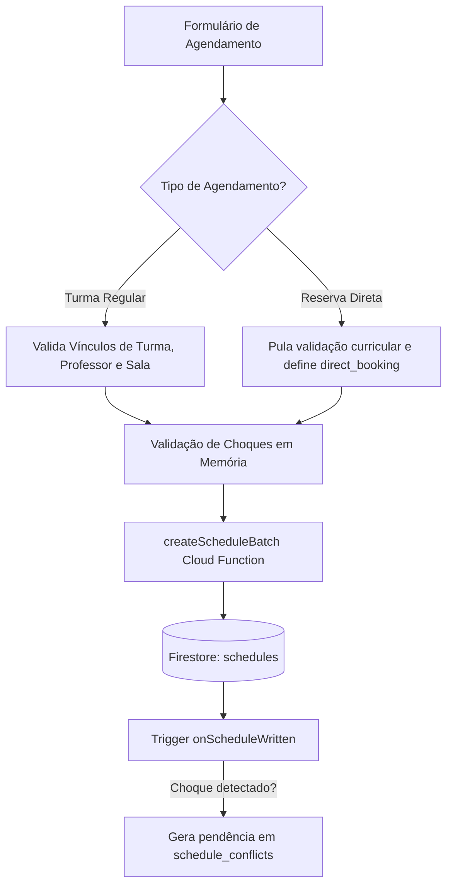
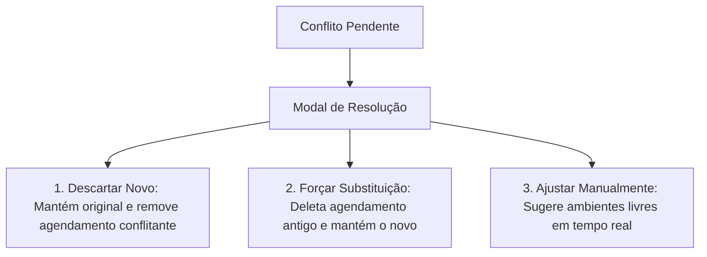

# Guia de Agendamentos e Gestão de Conflitos

Este guia detalha o fluxo operacional de agendamentos, o motor de detecção de colisões e o processo de resolução de sobreposições no **Macro Micro Schedule**.

---

## 1. Fluxo de Criação de Agendamentos

### 1.1. Agendamento de Turma Regular
* Seleciona-se Turma, Professor, Sala, Período de Datas e Dias da Semana.
* O sistema calcula os slots de horário conforme a carga horária da turma (`dailyWorkload`) e modelo (`3h`, `4h`, `5h`).

### 1.2. Reserva Direta (*Direct Booking*)
* Ativa-se a opção *"Reserva Direta"* no modal.
* O dropdown de turmas é substituído pelo campo de texto livre (*Nome do Evento*).
* Permite alocar qualquer docente ou o próprio usuário operador como responsável.

---

## 2. Motor de Detecção de Conflitos

A detecção de sobreposições opera em três níveis complementares:

### Nível 1: Validação Prévia no Frontend
Executada no formulário antes do envio, alertando visualmente o operador caso o professor, a sala ou a turma já possuam compromissos no horário.

### Nível 2: Validação Server-Side (Cloud Functions)
Utiliza cache indexado em memória (`getCachedSchedulesByTeacher`, `getCachedSchedulesByRoom`, `getCachedSchedulesByClass`) para verificar colisões antes da gravação.

### Nível 3: Triggers Reativos Assíncronos no Firestore
Gatilhos de backend monitoram o banco continuamente:
* **`onScheduleWritten`:** Disparado em toda inserção/atualização de agendamento. Se houver sobreposição, marca o agendamento como `conflict_flagged` e cria um documento na coleção `schedule_conflicts`.
* **`onRoomUpdated`:** Se um ambiente for desativado/colocado em manutenção (`available: false`), marca automaticamente todas as aulas futuras naquele ambiente como `conflict_flagged` e notifica os docentes envolvidos.
* **`onTeacherDeleted`:** Se um docente for excluído, marca suas aulas futuras como `teacher_missing` para que a coordenação aloque substitutos.

---

## 3. Hub de Resolução de Conflitos

O **Hub de Conflitos** ([ConflictModule.tsx](file:///c:/Users/VINICIUS/Documents/GitHub/macro-micro-schedule/src/components/modules/ConflictModule.tsx)) centraliza todas as divergências pendentes e oferece ferramentas de decisão:

### Ações de Resolução Disponíveis:
1. **Descartar Novo (`ignore`):**
   * Descarta o agendamento recém-criado/copiado que gerou o choque.
   * Mantém o agendamento preexistente intacto.
2. **Forçar Substituição (`accept_anyway`):**
   * Remove o registro concorrente anterior e consolida o novo agendamento com status `manually_adjusted`.
3. **Ajuste Inteligente de Ambiente / Professor (`resolve`):**
   * O sistema calcula dinamicamente **todos os ambientes livres da unidade no mesmo horário**.
   * O operador pode com um único clique remanejar a aula para uma sala vaga sem gerar novos choques.

---

## 4. Replicador Mensal de Grade

* Localizado no módulo de Agendamentos, permite copiar um mês letivo inteiro para o próximo.
* **Resiliência a Falhas:** Agendamentos sem conflito são gravados imediatamente; agendamentos com incompatibilidade de calendário ou sobreposição são enviados para o Hub de Conflitos.
* **Desfazer em Lote (*Undo*):** O botão *Desfazer Cópia* permite reverter em lote toda a operação criada por um `batchId` específico.
