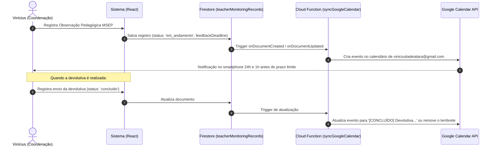

# Integração do Acompanhamento Docente com o Google Agenda

Este documento detalha as opções arquiteturais, configurações e o plano de implementação técnica para sincronizar os prazos de **Devolutivas Pedagógicas (SLA-01)** e vencimentos de **Planos de Ação (SLI-03)** do módulo de Acompanhamento Docente diretamente com o **Google Agenda** da Coordenação Pedagógica (`viniciusladeialara@gmail.com`).

---

## 1. Objetivo da Integração

* **Prevenção de Quebra de SLA:** Notificar proativamente a coordenação antes do vencimento do prazo regulamentar de 5 dias úteis para devolutivas pedagógicas (SLA-01 $\ge 95\%$).
* **Acompanhamento de Planos de Ação:** Emitir alertas sonoros e notificações push no smartphone e computador nos 3 dias antecedentes ao vencimento das ações pactuadas com docentes (SLI-03 $\ge 90\%$).
* **Produtividade & Centralização:** Permitir que o gestor visualize seus compromissos e prazos escolares em um único calendário corporativo sem precisar abrir o sistema diariamente.

---

## 2. Modelos Arquiteturais Avaliados

### Opção 1: Botão Direto "Adicionar ao Google Agenda" (Web Intent / 1 Clique)
> **Classificação:** Rápida, imediata e sem dependência de chaves de API ou renovação de tokens OAuth.

* **Como Funciona:**  
  Ao registrar ou visualizar uma observação pedagógica em [TeacherMonitoringModule.tsx](file:///c:/Users/VINICIUS/Documents/GitHub/macro-micro-schedule/src/components/modules/TeacherMonitoringModule.tsx), o sistema gera um botão com link formatado no padrão de URLs do Google Calendar.
* **Comportamento:**  
  Abre diretamente a interface do Google Agenda com o evento pré-preenchido, bastando clicar em **Salvar**.
* **Vantagens:**
  * Não requer configuração de Service Account nem aprovação no Google Cloud Console.
  * Funciona instantaneamente no navegador e no aplicativo móvel do Google Agenda.
  * Não gera custos de API nem risco de expiração de credenciais.

#### Exemplo de Estrutura da URL:
```typescript
export function buildGoogleCalendarUrl(params: {
  teacherName: string;
  deadlineDate: Date;
  roomName?: string;
  curricularUnit?: string;
}) {
  const title = `[SENAI] Devolutiva Pedagógica - ${params.teacherName}`;
  const startDate = format(params.deadlineDate, "yyyyMMdd");
  // Define o evento das 08:30 às 09:00 no dia limite
  const dates = `${startDate}T123000Z/${startDate}T130000Z`; 
  
  const description = [
    `Prazo regulamentar de devolutiva MSEP (SLA-01 - 5 dias úteis).`,
    `Docente: ${params.teacherName}`,
    params.curricularUnit ? `Unidade Curricular: ${params.curricularUnit}` : null,
    params.roomName ? `Ambiente: ${params.roomName}` : null,
    `Acessar Sistema: https://agendador-ambiente2.web.app/dashboard`
  ].filter(Boolean).join('\n');

  return `https://calendar.google.com/calendar/render?action=TEMPLATE`
    + `&text=${encodeURIComponent(title)}`
    + `&dates=${dates}`
    + `&details=${encodeURIComponent(description)}`
    + `&add=${encodeURIComponent('viniciusladeialara@gmail.com')}`;
}
```

---

### Opção 2: Sincronização 100% Automática em Background (Cloud Function + Service Account)
> **Classificação:** Experiência transparente e automatizada (o evento surge sozinho na agenda).



#### Passo a Passo de Configuração Técnica:
1. **Google Cloud Console (`agendador-ambiente2`):**
   * Ativar a **Google Calendar API**.
   * Criar uma Conta de Serviço (*Service Account*), ex.: `calendar-sync@agendador-ambiente2.iam.gserviceaccount.com`.
   * Gerar e baixar a chave JSON da Service Account (armazenada de forma segura nas Secrets do Firebase).
2. **Compartilhamento da Agenda Pessoal (`@gmail.com`):**
   * No Google Agenda de `viniciusladeialara@gmail.com`:
     * Clicar nos 3 pontinhos ao lado da agenda principal $\rightarrow$ **Configurações e Compartilhamento**.
     * Na seção **Compartilhar com pessoas específicas**, clicar em **Adicionar pessoas**.
     * Colar o e-mail da Service Account (`calendar-sync@agendador-ambiente2.iam.gserviceaccount.com`).
     * Conceder permissão: **"Fazer alterações nos eventos"**.
3. **Cloud Function de Integração:**
   * Biblioteca Node.js: `googleapis` (módulo `google.calendar('v3')`).
   * Escopos: `['https://www.googleapis.com/auth/calendar.events']`.
   * Disparo automático nas mutações da coleção `teacherMonitoringRecords`.

---

### Opção 3: Feed de Calendário por Assinatura (URL iCal / Webcal)
> **Classificação:** Cria uma agenda secundária no Google Calendar dedicada exclusivamente a "Prazos SENAI".

* **Como Funciona:**
  1. Uma Cloud Function HTTP gera dinamicamente um arquivo padrão `.ics` (RFC 5545) contendo todos os prazos ativos de devolutiva e planos de ação da unidade.
  2. No Google Agenda, o gestor adiciona o link em: **Outras agendas (+)** $\rightarrow$ **Do URL**.
  3. O Google Agenda cria uma camada de calendário própria (com cor dedicada), sincronizando as alterações a cada intervalo de horas.
* **Vantagens:**
  * Não mistura os prazos com a agenda pessoal do dia a dia.
  * Pode ser ocultada ou exibida com um clique na barra lateral do Google Agenda.

---

## 3. Formatação Padrão dos Eventos e Lembretes

| Campo | Padrão Recomendado |
|---|---|
| **Título** | `[SENAI] Devolutiva Pedagógica MSEP - Prof(a). {Nome}` |
| **Data do Evento** | Data exata de expiração do **SLA-01** (5 dias úteis após a aula observada) |
| **Horário Sugerido** | `08:30 às 09:00` (Início do expediente matutino) |
| **Lembretes Nativos do Google** | • 1 dia antes (24h) via notificação push no smartphone<br/>• 2 horas antes via pop-up na tela do computador<br/>• 30 minutos antes com alerta sonoro |
| **Descrição do Evento** | Inclui componente curricular, ambiente avaliado, práticas exitosas registradas e o link direto para dar baixa na devolutiva dentro do sistema. |

---

## 4. Plano de Ação para Implementação

1. **Fase 1 (Frontend Imediato):**
   * Implementar o botão **"Agendar no Google"** no modal de registro de acompanhamento e nos cards de alerta da Fila de Atenção no [TeacherMonitoringModule.tsx](file:///c:/Users/VINICIUS/Documents/GitHub/macro-micro-schedule/src/components/modules/TeacherMonitoringModule.tsx).
   * Disponibilizar também download direto de arquivo `.ics` para abertura em qualquer calendário.
2. **Fase 2 (Automação em Background):**
   * Configurar a Service Account no Google Cloud e ativar a Google Calendar API.
   * Desenvolver a Cloud Function v2 reativa para criação, atualização e encerramento de eventos em segundo plano.

---
*Documento registrado em 05/09/2026 para execução e acompanhamento.*
