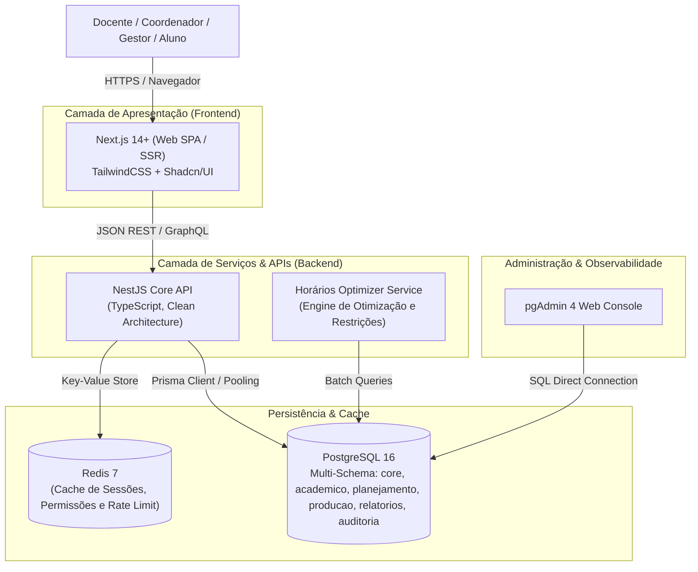
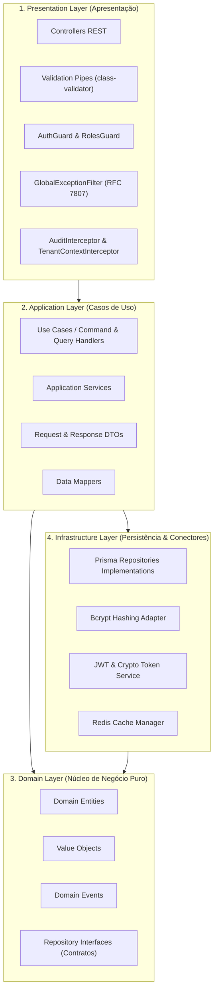
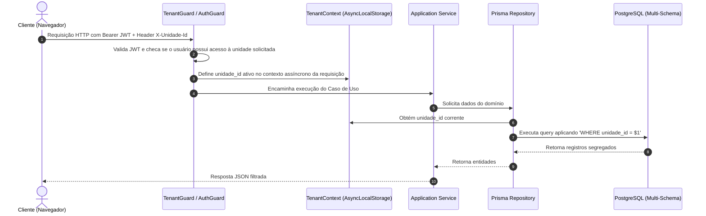
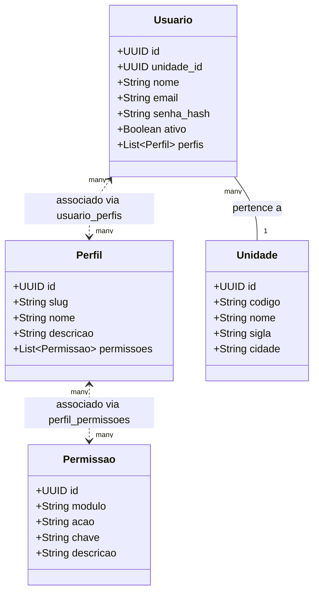
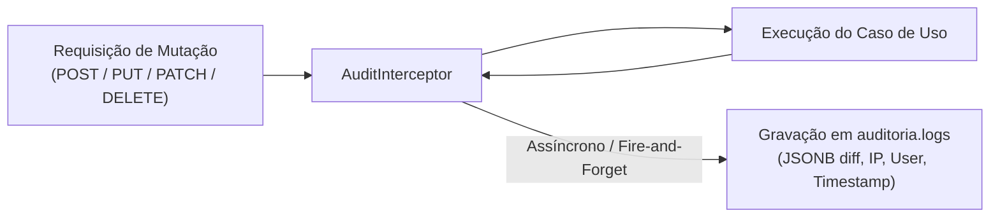

# SIRA – Arquitetura do Sistema
## Documento de Especificação Técnica & Arquitetural

---

### Metadados do Documento

| Atributo | Detalhe |
| :--- | :--- |
| **Projeto** | SIRA – Sistema Integrado de Recursos Acadêmicos |
| **Versão** | `1.0.0` |
| **Padrão Arquitetural** | Clean Architecture + Monorepo Modular (Feature-Based) |
| **Responsável** | Vinicius Lara |
| **Data** | Novembro / 2026 |

---

## 1. Visão Geral & Princípios Norteadores

O **SIRA** adota princípios sólidos de engenharia de software para garantir escalabilidade, testabilidade e manutenibilidade a longo prazo:

1. **Separação Estrita de Responsabilidades (SoC):** Regras de negócio desacopladas de frameworks de apresentação e mecanismos de persistência.
2. **Independência de Frameworks:** O núcleo de domínio não possui dependências de NestJS, Express ou Prisma.
3. **Multiunidade Nativa (Tenant Isolation):** Todo o fluxo de dados respeita o isolamento por unidade operacional do SENAI via discriminador `unidade_id UUID`.
4. **Segurança por Padrão (Secure by Default):** Modelo RBAC granular atômico (`modulo.acao`), tokens stateless efêmeros e renovação com rotação de refresh tokens.
5. **Rastreabilidade e Imutabilidade:** Toda alteração de dados gera trilha imutável no schema `auditoria` com payloads em `JSONB`.

---

## 2. Topologia do Sistema (C4 Model - Nível 2: Containers)



---

## 3. Arquitetura em Camadas do Backend (Clean Architecture)

A aplicação no backend (`apps/api`) é organizada em 4 círculos concêntricos:



### 3.1 Responsabilidades de Cada Camada

| Camada | Diretório Típico | Responsabilidade | Proibições |
| :--- | :--- | :--- | :--- |
| **Domain** | `src/domain/` ou `core/` | Entidades puras, regras invariantes e contratos de repositórios | Nunca importar pacotes externos como NestJS, Prisma ou HTTP |
| **Application** | `src/application/` | Orquestração dos fluxos de negócio, casos de uso, DTOs e validação lógica | Não tratar detalhes de transporte HTTP ou queries SQL diretas |
| **Infrastructure** | `src/infrastructure/` | Acesso ao PostgreSQL via Prisma, Redis, envio de email e integrações | Não conter regras de negócio essenciais |
| **Presentation** | `src/presentation/` | Controllers HTTP, rotas REST, DTOs de entrada e serialização de saída | Não executar lógica de banco ou cálculos de domínio |

---

## 4. Estratégia de Isolamento Multiunidade (Multi-tenancy)

O SENAI opera com unidades regionais independentes (ex: Cuiabá, Cáceres, Rondonópolis, Sinop).



### Regras Mandatórias de Multiunidade:
1. **Restrição por Tenant:** Toda consulta em tabelas de domínio (`academico`, `planejamento`, `producao`) deve conter o filtro `WHERE unidade_id = context.getTenantId()`.
2. **Superusuário (Administrador):** Apenas usuários com perfil `administrador` possuem permissão para trocar o `unidade_id` no cabeçalho ou consultar todas as unidades.
3. **Chave Estrangeira Obrigatória:** Nenhuma tabela transacional é criada sem chave estrangeira para `core.unidades(id)`.

---

## 5. Modelo de Segurança, Autenticação e RBAC



### 5.1 Ciclo de Vida do Token (JWT + Refresh Token)
- **Access Token:** JWT assinado com chave secreta (`HS256` ou `RS256`), tempo de vida curto (**15 a 60 minutos**), contendo `sub`, `email`, `unidade_id` e roles básicas.
- **Refresh Token:** Token opaco de alta entropia armazenado no Redis / PostgreSQL com tempo de vida de **7 dias**.
- **Rotação de Refresh Token:** A cada emissão de um novo access token, o refresh token anterior é revogado e substituído.

### 5.2 Avaliação de Permissões (RBAC Guard)
```typescript
@UseGuards(JwtAuthGuard, PermissionsGuard)
@RequirePermissions('usuarios.criar')
@Post()
async criarUsuario(@Body() dto: CreateUserDto) { ... }
```

---

## 6. Trilha de Auditoria Automatizada

A trilha de auditoria é tratada através de um **Interceptor Global de Auditoria** combinado com triggers de consistência no PostgreSQL:



### Estrutura do Delta Gravado em `JSONB`:
```json
{
  "dados_anteriores": {
    "nome": "João da Silva",
    "ativo": false
  },
  "dados_novos": {
    "nome": "João da Silva",
    "ativo": true
  }
}
```

---

## 7. Estratégia de Caching e Resiliência (Redis)

O Redis 7 atua em três frentes fundamentais:

1. **Cache de Permissões do Usuário:** Armazenamento das permissões resolvidas por usuário sob a chave `sira:perms:{usuarioId}` com TTL de 30 minutos (invalidação sob alteração de perfil).
2. **Lista Negra de Tokens Revogados (Denylist):** Bloqueio imediato de tokens em caso de logout ou alteração de senha.
3. **Rate Limiting Distribuído:** Proteção de rotas sensíveis (`/auth/login`, `/auth/esqueci-senha`) limitando requisições abusivas por IP.

---

## 8. Tratamento Global de Erros & Padrão de Resposta

Erros na API devem seguir a especificação **RFC 7807 (Problem Details for HTTP APIs)**:

```json
{
  "type": "https://sira.senai.br/errors/unauthorized",
  "title": "Acesso Negado",
  "status": 403,
  "detail": "O usuário não possui a permissão 'turmas.editar' na unidade SENAI Cuiabá.",
  "instance": "/api/v1/turmas/a0eebc99-9c0b-4ef8-bb6d-6bb9bd380a11",
  "timestamp": "2026-11-06T23:45:00.000Z",
  "traceId": "req-98f2b3e1-4c62-411a-82cf-e83c07641f92"
}
```

---

## 9. Observabilidade e Logging Estruturado

- **Logger:** Winston configurado com saída em JSON nos ambientes de produção e saída colorida formatada em desenvolvimento.
- **Trace Context:** Cada requisição recebe um cabeçalho `X-Trace-Id` que trafega entre os logs da aplicação, do banco e de auditoria para correlação direta de incidentes.
