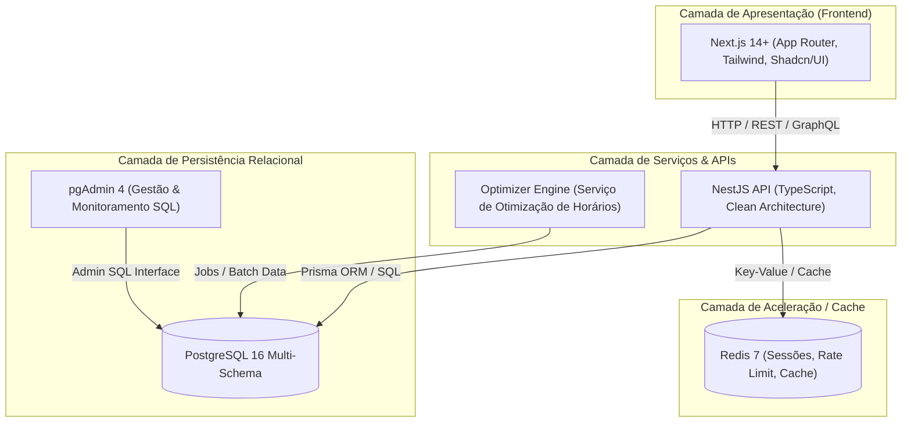
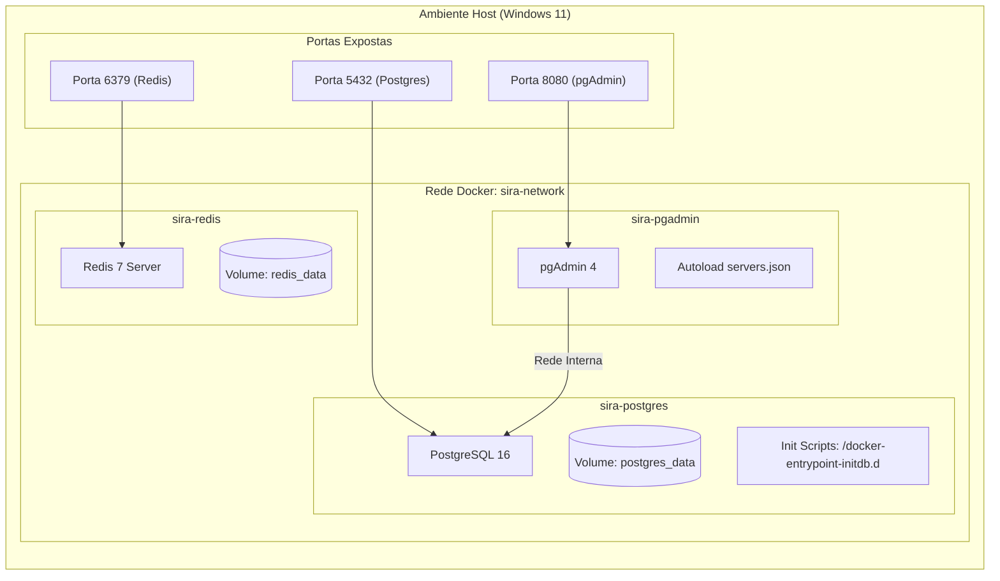
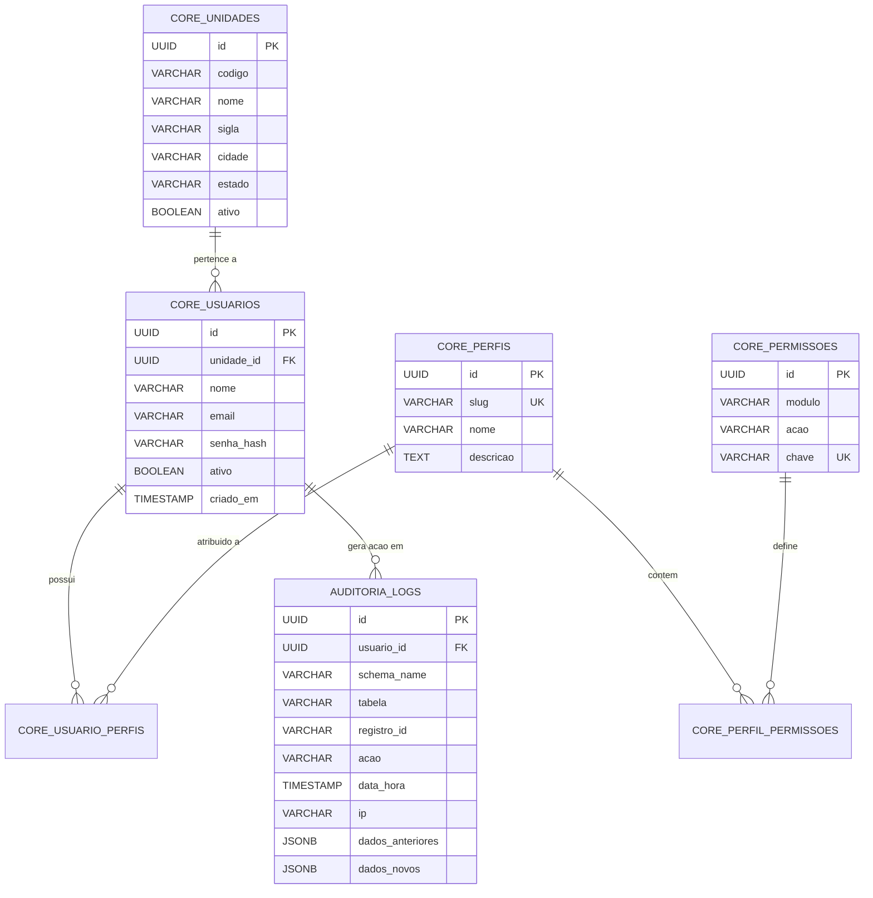
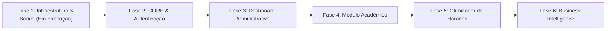

# SIRA – Sistema Integrado de Recursos Acadêmicos
## PRD – Documento de Requisitos do Produto (Product Requirements Document)

---

### Metadados do Documento

| Atributo | Detalhe |
| :--- | :--- |
| **Projeto** | SIRA – Sistema Integrado de Recursos Acadêmicos |
| **Versão** | `1.0.0` |
| **Status** | `Fase 1: Infraestrutura & Fundação Técnica (Em Execução)` |
| **Responsável** | Vinicius Lara |
| **Organização** | SENAI |
| **Data de Emissão** | Novembro / 2026 |
| **Classificação** | Interno / Engenharia de Software |

---

## Sumário Executivo

O **SIRA (Sistema Integrado de Recursos Acadêmicos)** é uma plataforma integrada, modular e de alta disponibilidade projetada para centralizar a gestão operacional, acadêmica e administrativa das unidades operacionais do SENAI.

A arquitetura adota o paradigma de **Monorepo Modular**, fundamentada em contêineres Docker, separação estrita por camadas (Clean Architecture), persistência relacional com PostgreSQL 16, cache em memória com Redis 7 e barramento desacoplado para futuras aplicações em NestJS e Next.js.

> [!IMPORTANT]
> **Regra de Ouro da Fase 1**: Nenhuma funcionalidade de negócio ou tela será implementada antes da total conclusão e validação da fundação técnica, infraestrutura de contêineres, segregação de schemas e modelagem de segurança/auditoria.

---

## Tabela de Conteúdos

1. [Visão Geral & Escopo](#1-visão-geral--escopo)
2. [Objetivos da Fase 1 (Infraestrutura Base)](#2-objetivos-da-fase-1-infraestrutura-base)
3. [Topologia e Arquitetura do Sistema](#3-topologia-e-arquitetura-do-sistema)
4. [Estrutura do Monorepo](#4-estrutura-do-monorepo)
5. [Stack Tecnológico Oficial](#5-stack-tecnológico-oficial)
6. [Especificação da Infraestrutura Docker](#6-especificação-da-infraestrutura-docker)
7. [Modelagem do Banco de Dados & Schemas](#7-modelagem-do-banco-de-dados--schemas)
8. [Multiunidade (Multi-tenancy)](#8-multiunidade-multi-tenancy)
9. [Módulo de Segurança & RBAC](#9-módulo-de-segurança--rbac)
10. [Módulo de Auditoria & Rastreabilidade](#10-módulo-de-auditoria--rastreabilidade)
11. [Padrões de Desenvolvimento & Convenções](#11-padrões-de-desenvolvimento--convenções)
12. [Observabilidade, Logging & Monitoramento](#12-observabilidade-logging--monitoramento)
13. [Critérios de Aceite da Fase 1](#13-critérios-de-aceite-da-fase-1)
14. [Não-Escopo da Fase 1](#14-não-escopo-da-fase-1)
15. [Roadmap do Projeto](#15-roadmap-do-projeto)

---

## 1. Visão Geral & Escopo

O ecossistema SENAI opera com múltiplas unidades descentralizadas, cada uma com seus próprios cursos, turmas, docentes, ambientes laboratoriais e demandas de planejamento. O SIRA nasce para unificar essas operações sob um modelo robusto, auditável e seguro.



---

## 2. Objetivos da Fase 1 (Infraestrutura Base)

Construir e validar um ambiente local de desenvolvimento rigorosamente padronizado, automatizado e reprodutível, contendo:

- [x] Provisionamento de contêineres Docker (PostgreSQL 16, pgAdmin 4, Redis 7).
- [x] Configuração da rede interna (`sira-network`) e volumes de dados com retenção persistente.
- [x] Criação da topologia monorepo conforme padrão de engenharia.
- [x] Criação automatizada de todos os schemas PostgreSQL (`core`, `academico`, `planejamento`, `producao`, `relatorios`, `auditoria`).
- [x] Estrutura relacional e tabelas de referência para segurança, usuários, perfis e permissões granulares.
- [x] Estrutura para suporte nativo a multiunidade (`unidade_id UUID`).
- [x] Estrutura e modelo de dados para trilha de auditoria completa em `JSONB`.
- [x] Configuração pré-definida de conexão para o pgAdmin sem atrito de onboarding.
- [x] Controle de versão Git com `.gitignore` e documentação operacional completa.

---

## 3. Topologia e Arquitetura do Sistema



---

## 4. Estrutura do Monorepo

O repositório adota a seguinte arquitetura de pastas padronizada:

```text
SIRA/
├── apps/                          # Aplicações executáveis
│   ├── api/                       # Backend API NestJS
│   ├── web/                       # Frontend Web Next.js
│   └── optimizer/                 # Motor de otimização de matriz de horários
├── core/                          # Regras de negócio puras, entidades e contratos centrais
├── modules/                       # Módulos de domínio encapsulados
├── plugins/                       # Extensões e integrações secundárias
├── shared/                        # Tipos, constantes, DTOs e utilitários compartilhados
├── infrastructure/                # Configurações de infraestrutura como código (IaC)
│   └── docker/                    # Arquivos e configurações Docker
│       └── pgadmin/               # Configurações de auto-descoberta do pgAdmin (servers.json)
├── database/                      # Artefatos de banco de dados
│   ├── init/                      # Scripts SQL executados na inicialização do contêiner
│   │   ├── 01_extensions.sql      # Extensões do PostgreSQL (uuid, pgcrypto)
│   │   ├── 02_schemas.sql         # Criação dos schemas lógicos
│   │   ├── 03_core_tables.sql     # Tabelas do schema core (unidades, usuários, RBAC)
│   │   ├── 04_auditoria_tables.sql# Tabelas do schema de auditoria
│   │   └── 05_seed_data.sql       # Carga inicial de unidades SENAI e perfis
│   └── migrations/                # Migrações gerenciadas pelo Prisma ORM
├── docs/                          # Documentação de arquitetura, PRDs e guias
│   └── PRD.md                     # Documento de Requisitos do Produto
├── tests/                         # Testes e2e e suites integradas transversais
├── .env                           # Variáveis de ambiente locais (não versionadas)
├── .env.example                   # Template de variáveis de ambiente de referência
├── .gitignore                     # Regras de exclusão do Git
├── README.md                      # Documentação operacional do projeto
└── docker-compose.yml             # Manifesto de orquestração de contêineres principal
```

---

## 5. Stack Tecnológico Oficial

| Camada | Tecnologia | Versão | Função / Justificativa |
| :--- | :--- | :--- | :--- |
| **Backend** | NestJS | 10.x / LTS | Arquitetura modular, injeção de dependências e escalabilidade corporativa |
| **Linguagem Backend** | TypeScript | 5.x | Tipagem estrita e robustez de compilação |
| **Frontend** | Next.js | 14+ (App Router) | SSR/SSG híbrido, alta performance e ecossistema React moderno |
| **Estilização** | TailwindCSS | 3.4+ | Framework utilitário de produtividade consistente |
| **Design System** | Shadcn/UI | Última | Componentes acessíveis, customizáveis e headless |
| **Biblioteca de Ícones** | Lucide React | Última | Conjunto limpo e consistente de ícones vetoriais |
| **Banco de Dados** | PostgreSQL | 16 | RDBMS relacional com suporte a schemas nativos, JSONB e integridade referencial |
| **Gestão do Banco** | pgAdmin 4 | Última | Interface web oficial para administração do banco de dados |
| **Cache & Filas** | Redis | 7 | Cache distribuído em memória e controle de fila de jobs |
| **ORM** | Prisma | Última | Abstração typesafe do banco de dados e migrações declarativas |
| **Autenticação** | JWT + Refresh Token | - | Autenticação stateless com renovação via rota segura |
| **Autorização** | RBAC Granular | - | Controle de acesso baseado em perfis e permissões explícitas |
| **Logging** | Winston / Pino | - | Logs estruturados com formato JSON e níveis de severidade |

---

## 6. Especificação da Infraestrutura Docker

A orquestração local utiliza Docker Compose integrado com redes isoladas e volumes persistentes.

### 6.1 Matriz de Serviços

| Serviço | Nome do Contêiner | Imagem Oficial | Porta Exposta | Volume Persistente | Propósito |
| :--- | :--- | :--- | :--- | :--- | :--- |
| **PostgreSQL** | `sira-postgres` | `postgres:16-alpine` | `5432:5432` | `postgres_data:/var/lib/postgresql/data` | Banco de dados relacional principal |
| **pgAdmin** | `sira-pgadmin` | `dpage/pgadmin4:latest` | `8080:80` | `pgadmin_data:/var/lib/pgadmin` | Ferramenta visual de administração SQL |
| **Redis** | `sira-redis` | `redis:7-alpine` | `6379:6379` | `redis_data:/data` | Cache em memória e controle de concorrência |

### 6.2 Parâmetros de Configuração dos Serviços

#### PostgreSQL (`sira-postgres`)
- **Porta**: `5432`
- **Banco Padrão**: `sira`
- **Usuário Padrão**: `sira_admin`
- **Senha Padrão**: `Sira@2026`
- **Volume de Inicialização**: `./database/init:/docker-entrypoint-initdb.d:ro`
- **Healthcheck**: Execução periódica de `pg_isready -U sira_admin -d sira`

#### pgAdmin 4 (`sira-pgadmin`)
- **Porta**: `8080` (Acesso em `http://localhost:8080`)
- **Email Padrão**: `admin@sira.com`
- **Senha Padrão**: `Admin@2026`
- **Auto-Configuração**: Pré-carga de servidor PostgreSQL através do arquivo `servers.json`, eliminando a necessidade de cadastro manual na interface.

#### Redis 7 (`sira-redis`)
- **Porta**: `6379`
- **Healthcheck**: `redis-cli ping`
- **Persistência**: Append-only file habilitado opcionalmente via volume `redis_data`.

---

## 7. Modelagem do Banco de Dados & Schemas

Para evitar o acoplamento monolítico em um único namespace `public`, o banco de dados é segregado em **6 Schemas Lógicos**:



### 7.1 Catálogo de Schemas

| Schema | Finalidade Principal |
| :--- | :--- |
| `core` | Gestão de identidades, autenticação, controle de acesso (RBAC), unidades operacionais e parâmetros globais. |
| `academico` | Cursos, matrizes curriculares, disciplinas/unidades curriculares, turmas, matrículas, docentes e alunos. |
| `planejamento` | Alocação de recursos, calendários letivos, quadros de horários, disponibilidade docente e restrições de salas/laboratórios. |
| `producao` | Execução de aulas, apontamento de frequência, registro de notas, entregas de planos e diários de classe. |
| `relatorios` | Visões materializadas, estruturas analíticas agregadas para BI, dashboards de indicadores e relatórios institucionais. |
| `auditoria` | Trilha imutável de eventos de auditoria (INSERT, UPDATE, DELETE, LOGIN, LOGOUT), rastreabilidade de IPs e payloads JSONB. |

---

## 8. Multiunidade (Multi-tenancy)

O SIRA adota o modelo de **Segregação Lógica por Tenant** com colunas discriminadoras (`unidade_id UUID`) referenciando a tabela `core.unidades`.

```text
Exemplos de Unidades Operacionais Padrão:
├── SENAI Cáceres
├── SENAI Cuiabá
├── SENAI Rondonópolis
└── SENAI Sinop
```

### Regras de Governança Multiunidade:
1. **Chave Estrangeira Mandatória**: Todas as tabelas de domínio nos schemas `academico`, `planejamento` e `producao` devem possuir uma coluna `unidade_id UUID NOT NULL REFERENCES core.unidades(id)`.
2. **Índice Composto**: Índices de busca e unicidade devem incluir `unidade_id` como primeiro ou segundo campo para garantir performance otimizada de consultas por unidade.
3. **Isolamento na Aplicação**: A camada de serviço do NestJS deve injetar automaticamente o filtro de `unidade_id` em tempo de execução via Middleware / Guard de contexto da requisição.

---

## 9. Módulo de Segurança & RBAC

O controle de acesso é baseado no modelo **RBAC (Role-Based Access Control)** granular por permissões atômicas.

### 9.1 Perfis Padrão do Sistema (`core.perfis`)

- `Administrador`: Acesso irrestrito a todas as funções e unidades do sistema.
- `Gestor`: Gestão administrativa e relatórios de sua respectiva unidade.
- `Coordenador`: Gestão de turmas, docentes, calendários e matrizes da unidade.
- `Professor`: Acesso aos seus diários de classe, frequências e conteúdos programáticos.
- `Secretaria`: Operações cadastrais de turmas, alunos e matrículas.
- `Consulta`: Visualização restrita sem privilégio de alteração.

### 9.2 Estrutura Granular de Permissões (`core.permissoes`)

As permissões seguem o padrão `modulo.acao`:

| Módulo | Ação | Chave da Permissão | Descrição |
| :--- | :--- | :--- | :--- |
| `usuarios` | `ler` | `usuarios.ler` | Consultar catálogo de usuários |
| `usuarios` | `criar` | `usuarios.criar` | Cadastrar novo usuário |
| `usuarios` | `editar` | `usuarios.editar` | Alterar dados cadastrais |
| `usuarios` | `excluir` | `usuarios.excluir` | Inativar ou remover usuário |
| `turmas` | `ler` | `turmas.ler` | Consultar turmas e horários |
| `turmas` | `editar` | `turmas.editar` | Modificar turmas e alocações |
| `relatorios` | `gerar` | `relatorios.gerar` | Emitir relatórios consolidados |

---

## 10. Módulo de Auditoria & Rastreabilidade

O schema `auditoria` garante conformidade, segurança da informação e governança sobre todas as modificações no banco de dados.

### 10.1 Eventos Auditados
- `INSERT`: Criação de registros de domínio.
- `UPDATE`: Alterações com armazenamento de estado anterior e novo (`JSONB`).
- `DELETE`: Exclusões físicas ou marcações de expurgo.
- `LOGIN`: Autenticações bem-sucedidas ou rejeitadas.
- `LOGOUT`: Encerramento voluntário de sessões.

### 10.2 Estrutura do Registro de Auditoria (`auditoria.logs`)

```sql
CREATE TABLE IF NOT EXISTS auditoria.logs (
    id UUID PRIMARY KEY DEFAULT gen_random_uuid(),
    usuario_id UUID,
    usuario_email VARCHAR(255),
    unidade_id UUID,
    schema_name VARCHAR(100) NOT NULL,
    tabela VARCHAR(100) NOT NULL,
    registro_id VARCHAR(255),
    acao VARCHAR(50) NOT NULL,
    data_hora TIMESTAMPTZ NOT NULL DEFAULT CURRENT_TIMESTAMP,
    ip VARCHAR(45),
    user_agent TEXT,
    dados_anteriores JSONB,
    dados_novos JSONB
);
```

---

## 11. Padrões de Desenvolvimento & Convenções

### 11.1 Arquitetura de Software
- **Clean Architecture**: Regras de negócio desacopladas de frameworks de apresentação e de drivers de persistência.
- **Feature-Based**: Módulos organizados em torno de casos de uso e domínios de negócio (ex: `/usuarios`, `/turmas`, `/alocacao`).

### 11.2 Convenções de Nomenclatura e Idioma
- **Regras de Negócio e Banco de Dados**: Nomes em **Português** (ex: `usuarios`, `unidades`, `perfis`, `permissoes`, `turmas`).
- **Código-fonte e Estruturas de Classes**: Identificadores em **Inglês** (ex: `UserService`, `UserController`, `AuthGuard`, `PrismaService`).

---

## 12. Observabilidade, Logging & Monitoramento

- **Logging**: Preparado para logging estruturado via `Winston` ou `Pino` com formato JSON padronizado.
  - Logs obrigatórios: Erros não tratados, autenticações/sessões, alterações críticas de auditoria e tempos de resposta de requisições.
- **Métricas**: Estrutura preparada para exposição de endpoint `/metrics` compatível com **Prometheus** e dashboards no **Grafana** (implementação prevista em fases posteriores).

---

## 13. Critérios de Aceite da Fase 1

| Item | Critério de Aceite | Status | Verificação |
| :---: | :--- | :---: | :--- |
| **CA-01** | Estrutura de pastas monorepo devidamente criada e padronizada. | ✅ | Inspeção do sistema de arquivos |
| **CA-02** | Docker Compose funcional com serviços `postgres`, `pgadmin` e `redis`. | ✅ | `docker compose ps` |
| **CA-03** | PostgreSQL 16 em execução com porta 5432 acessível e volume persistente. | ✅ | Teste de socket e query SQL |
| **CA-04** | pgAdmin 4 em execução na porta 8080 com acesso sem erro via navegador. | ✅ | Requisição HTTP em `http://localhost:8080` |
| **CA-05** | Redis 7 em execução na porta 6379 respondendo ao comando `PING`. | ✅ | `redis-cli ping` |
| **CA-06** | Schemas criados automaticamente no boot (`core`, `academico`, etc.). | ✅ | Consulta de schemas via SQL |
| **CA-07** | Banco acessível e autoconfigurado no pgAdmin através de `servers.json`. | ✅ | Conexão automática validada |
| **CA-08** | Documentação completa do ambiente e guias operacionais gerados. | ✅ | `README.md` e `docs/PRD.md` |
| **CA-09** | Repositório versionado com Git, `.gitignore` adequado e commit inicial. | ✅ | `git log` |
| **CA-10** | Ambiente 100% reprodutível por outro desenvolvedor via comando único. | ✅ | Validação do fluxo de setup |

---

## 14. Não-Escopo da Fase 1

Para garantir foco e qualidade na infraestrutura base, **os seguintes itens NÃO fazem parte da Fase 1**:
- Telas ou interfaces visuais do sistema (Frontend Next.js).
- Dashboards analíticos ou gráficos.
- Relatórios operacionais em PDF ou Excel.
- Algoritmo do motor de otimização de matriz horária.
- Integrações com sistemas legados ou ERP corporativo.
- Rotas completas da API acadêmica.
- Sistema de chamados ou helpdesk.

---

## 15. Roadmap do Projeto



- **Fase 1**: Fundação Técnica, Docker, PostgreSQL, Schemas e Auditoria *(Atual)*.
- **Fase 2**: Módulo CORE, NestJS, Autenticação JWT, Gestão de Usuários, Perfis e Unidades.
- **Fase 3**: Dashboard Administrativo em Next.js e Gestão de Cadastros Base.
- **Fase 4**: Módulo Acadêmico (Cursos, Turmas, Matrizes e Diários).
- **Fase 5**: Motor Otimizador de Alocação de Horários e Salas.
- **Fase 6**: Business Intelligence e Painéis Analíticos Gerenciais.
