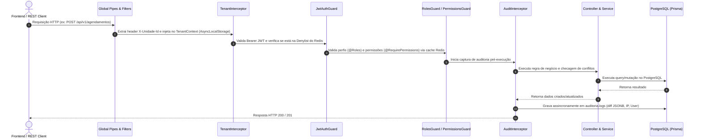

# SIRA – Guia de Engenharia do Backend (API NestJS)

Este documento é a referência técnica completa para **Desenvolvedores Backend e Full Stack** que atuam na API do **SIRA** (`apps/api`).

---

## 📌 Sumário
1. [Visão Geral & Stack Tecnológico](#1-visão-geral--stack-tecnológico)
2. [Estrutura de Pastas de `apps/api`](#2-estrutura-de-pastas-de-appsapi)
3. [Ciclo de Vida da Requisição HTTP (Pipeline)](#3-ciclo-de-vida-da-requisição-http-pipeline)
4. [Prisma ORM Multi-Schema](#4-prisma-orm-multi-schema)
5. [Segurança, Autenticação JWT e RBAC Granular](#5-segurança-autenticação-jwt-e-rbac-granular)
6. [Isolamento Multiunidade (`TenantContext`)](#6-isolamento-multiunidade-tenantcontext)
7. [Motor de Conflitos de Agendamento](#7-motor-de-conflitos-de-agendamento)
8. [Módulo de Sincronização & Promoção (`SyncModule`)](#8-módulo-de-sincronização--promoção-syncmodule)
9. [Como Criar um Novo Módulo no Backend (Passo a Passo)](#9-como-criar-um-novo-módulo-no-backend-passo-a-passo)
10. [Comandos de Teste e Compilação](#10-comandos-de-teste-e-compilação)

---

## 1. Visão Geral & Stack Tecnológico

| Componente | Tecnologia | Papel |
| :--- | :--- | :--- |
| **Framework** | NestJS 10 + Fastify/Express | Clean Architecture, Injeção de Dependências e Módulos |
| **Linguagem** | TypeScript 5+ (ESM / NodeNext) | Tipagem estrita ponta a ponta |
| **ORM** | Prisma ORM 5+ | Mapeamento declarativo multi-schema (`previewFeatures = ["multiSchema"]`) |
| **Cache & Filas** | ioredis + Redis 7 | Cache de permissões, rate limiting e denylist de tokens |
| **Criptografia** | Bcrypt + Crypto | Hashing de senhas e geração de UUIDv4 |
| **Tratamento de Erros** | RFC 7807 (Problem Details) | Respostas padronizadas para clientes REST |

---

## 2. Estrutura de Pastas de `apps/api`

```text
apps/api/
├── prisma/
│   └── schema.prisma                  # Definição multi-schema (core, academico, planejamento, etc.)
├── src/
│   ├── infrastructure/                # Adaptadores de infraestrutura e serviços globais
│   │   ├── prisma/                    # PrismaService (singleton com lifecycle de conexão)
│   │   ├── redis/                     # RedisCacheService (get, set, del, denylist, rateLimit)
│   │   ├── filters/                   # HttpExceptionFilter (RFC 7807)
│   │   └── interceptors/              # AuditInterceptor (captura de deltas e gravação de logs)
│   │
│   ├── modules/                       # Módulos encapsulados de domínio (Feature-Based)
│   │   ├── auth/                      # Login, refresh tokens, JwtAuthGuard, CurrentUser
│   │   ├── rbac/                      # RolesGuard, PermissionsGuard, RbacService, decorators
│   │   ├── tenant/                    # TenantContext (AsyncLocalStorage), TenantInterceptor
│   │   ├── users/                     # CRUD de usuários e hashing bcrypt
│   │   ├── units/                     # Unidades SENAI e busca por código/cidade
│   │   ├── roles/                     # Perfis e catálogo de permissões
│   │   ├── ambientes/                 # Salas, laboratórios de informática, galpões
│   │   ├── cursos/                    # Cursos técnicos e matrizes
│   │   ├── docentes/                  # Professores e carga horária máxima semanal
│   │   ├── turmas/                    # Turmas vinculadas a cursos e turnos
│   │   ├── agendamentos/              # Planejamento de aulas com DETECTOR DE CONFLITOS
│   │   ├── feriados/                  # Feriados nacionais, estaduais e municipais
│   │   ├── substituicoes/             # Troca de turnos e professores substitutos
│   │   └── sync/                      # Espelhamento Produção <-> Teste e Promoção com Senha
│   │
│   ├── app.module.ts                  # Módulo raiz agregador
│   └── main.ts                        # Bootstrap da aplicação (porta 3000, prefixo /api/v1)
├── package.json
└── tsconfig.json
```

---

## 3. Ciclo de Vida da Requisição HTTP (Pipeline)

Toda requisição que entra na API passa pela seguinte sequência estrita de middlewares e interceptors:



---

## 4. Prisma ORM Multi-Schema

No `apps/api/prisma/schema.prisma`, habilitamos o suporte nativo a múltiplos schemas do PostgreSQL:

```prisma
generator client {
  provider        = "prisma-client-js"
  previewFeatures = ["multiSchema"]
}

datasource db {
  provider = "postgresql"
  url      = env("DATABASE_URL")
  schemas  = ["academico", "auditoria", "core", "planejamento", "producao", "relatorios"]
}
```

### Comandos Essenciais do Prisma:
```bash
# Atualizar tipos do Prisma após alterar tabelas no PostgreSQL:
npm --prefix apps/api run db:pull
npm --prefix apps/api run db:generate

# Abrir o Prisma Studio para visualização interativa dos dados:
npx prisma studio
```

---

## 5. Segurança, Autenticação JWT e RBAC Granular

### 1. Autenticação (`AuthModule`)
- **Login:** `POST /api/v1/auth/login` (validação bcrypt, emissão de Access Token com validade de 1h e Refresh Token no Redis com validade de 7 dias).
- **Refresh Token:** `POST /api/v1/auth/refresh` (renovação atômica com invalidação do refresh token anterior no Redis).
- **Logout:** `POST /api/v1/auth/logout` (insere o access token na denylist do Redis até sua expiração natural).

### 2. Controle de Acesso Baseado em Perfis e Permissões (RBAC)
Para proteger um endpoint, basta utilizar os decoradores oficiais:

```typescript
// Exigir perfil de Administrador ou Gestor:
@Roles('administrador', 'gestor')
@UseGuards(RolesGuard)
@Get('relatorios')
async obterRelatorios() { ... }

// Exigir permissão granular atômica:
@RequirePermissions('turmas.criar')
@UseGuards(PermissionsGuard)
@Post('turmas')
async criarTurma(@Body() dto: CreateTurmaDto) { ... }
```

---

## 6. Isolamento Multiunidade (`TenantContext`)

Cada requisição do frontend envia o cabeçalho `X-Unidade-Id: <UUID_DA_UNIDADE>`.
- O `TenantInterceptor` intercepta esse cabeçalho e o registra de forma segura no contexto assíncrono da requisição utilizando a API nativa `AsyncLocalStorage` do Node.js.
- Nos controllers e services, para obter a unidade ativa sem passar parâmetros manualmente:

```typescript
@Get()
async listarCursos(@CurrentTenant() tenantId: string | null) {
  return this.cursosService.findAll(tenantId);
}
```
*Superusuários (administradores) podem omitir o cabeçalho `X-Unidade-Id` para consultar recursos de todas as unidades consolidadas.*

---

## 7. Motor de Conflitos de Agendamento

O `AgendamentosService` possui um algoritmo rigoroso para impedir sobreposição de horários:

```typescript
// Regra de colisão: data_inicio < novo_fim AND data_fim > novo_inicio
async checkConflicts(ambienteId: string, docenteId: string, dataInicio: Date, dataFim: Date, excludeId?: string) {
  // 1. Checa se a sala física já está alocada para outra turma
  // 2. Checa se o docente já está alocado para outra turma
  // Se houver colisão -> lança ConflictException (HTTP 409) com mensagem detalhada
}
```

---

## 8. Módulo de Sincronização & Promoção (`SyncModule`)

Localizado em [`apps/api/src/modules/sync/`](file:///c:/Users/VINICIUS/Documents/GitHub/SIRA/apps/api/src/modules/sync/):

### Métodos Principais do `SyncService`:
1. `getSyncStatus()`: Retorna estatísticas de Produção (`sira`) versus Teste (`sira_teste`).
2. `validateScenario(unidadeId?)`: Realiza a validação prévia de conflitos de horários em `sira_teste`. Se houver choques de salas ou docentes, bloqueia o envio.
3. `mirrorProdToTest(adminEmail, dto)`: Clona a produção para o ambiente de testes de forma não bloqueante (`REPEATABLE READ`).
4. `promoteTestToProd(adminEmail, dto)`:
   - Valida senha do administrador via Bcrypt.
   - Verifica se o cenário tem 0 conflitos.
   - Abre uma transação atômica (`$transaction`) no banco de produção.
   - Executa `upsert` idempotente de cursos, ambientes, docentes, turmas, feriados e agendamentos.
   - Registra log de auditoria em `auditoria.logs`.

---

## 9. Como Criar um Novo Módulo no Backend (Passo a Passo)

Para criar um novo módulo no SIRA (ex: `recursos_materiais`):

1. **Criar a tabela no PostgreSQL** (adicionar o script SQL ou migração).
2. **Atualizar o Prisma:**
   ```bash
   npm --prefix apps/api run db:pull
   npm --prefix apps/api run db:generate
   ```
3. **Criar a estrutura do módulo:**
   - `apps/api/src/modules/recursos/dto/create-recurso.dto.ts`
   - `apps/api/src/modules/recursos/dto/update-recurso.dto.ts`
   - `apps/api/src/modules/recursos/recursos.service.ts`
   - `apps/api/src/modules/recursos/recursos.controller.ts`
   - `apps/api/src/modules/recursos/recursos.module.ts`
4. **Proteger os endpoints com Guards:**
   ```typescript
   @Controller('recursos')
   @UseGuards(PermissionsGuard)
   export class RecursosController {
     @Get()
     @RequirePermissions('recursos.ler')
     async findAll() { ... }
   }
   ```
5. **Registrar o novo módulo no `app.module.ts`**.

---

## 10. Comandos de Teste e Compilação

```bash
# Executar a API em modo desenvolvimento com auto-reload (watch):
npm --prefix apps/api run start:dev

# Executar bateria de testes do fluxo acadêmico e regras de conflito:
node apps/api/test-academic-flow.mjs

# Executar bateria de testes de sincronização e promoção entre bancos:
node apps/api/test-sync-flow.mjs

# Compilar a API para produção (validação de build TypeScript):
npm --prefix apps/api run build
```
