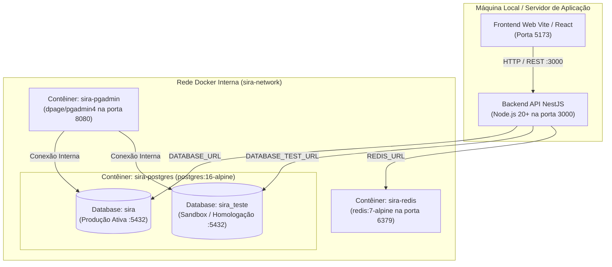

# SIRA – Guia de Engenharia de Infraestrutura & DevOps

Este documento reúne todas as especificações técnicas, decisões arquiteturais de infraestrutura, topologia de rede, gestão de dados e processos de deployment que um **Desenvolvedor Full Stack / DevOps** precisa para operar, escalar e manter o **SIRA (Sistema Integrado de Recursos Acadêmicos)**.

---

## 📌 Sumário
1. [Topologia Geral de Infraestrutura](#1-topologia-geral-de-infraestrutura)
2. [PostgreSQL 16 Multi-Schema](#2-postgresql-16-multi-schema)
3. [Arquitetura de Duplo Banco (Produção vs Homologação/Teste)](#3-arquitetura-de-duplo-banco-produção-vs-homologaçãoteste)
4. [Redis 7 (Cache, Filas e Sessões)](#4-redis-7-cache-filas-e-sessões)
5. [pgAdmin 4 (Console de Administração)](#5-pgadmin-4-console-de-administração)
6. [Docker Compose & Redes Locais](#6-docker-compose--redes-locais)
7. [Scripts de Inicialização (`database/init/`) e Cargas (`database/seeds/`)](#7-scripts-de-inicialização-e-cargas)
8. [Estratégia de Escala Enterprise & Migração para Nuvem (AWS / GCP / Azure)](#8-estratégia-de-escala-enterprise--migração-para-nuvem)
9. [Comandos Rápidos de DevOps](#9-comandos-rápidos-de-devops)

---

## 1. Topologia Geral de Infraestrutura

O ambiente local do SIRA é orquestrado através do Docker Compose, composto por 3 contêineres principais integrados em uma rede bridge dedicada (`sira-network`):



---

## 2. PostgreSQL 16 Multi-Schema

Diferente de sistemas que utilizam bancos de dados separados para cada microsserviço ou o schema único `public`, o SIRA adota uma **Arquitetura Multi-Schema Consolidada** dentro da mesma instância de PostgreSQL. Essa abordagem entrega:
- **Separação lógica estrita de domínios** (acesso concedido por schema via RBAC).
- **Consultas transacionais de alta performance** (zero overhead de distributed transactions).
- **Integridade referencial estrita** entre módulos através de foreign keys UUID.

### Os 6 Schemas do SIRA:

| Schema | Finalidade | Principais Tabelas |
| :--- | :--- | :--- |
| **`core`** | Identidade, unidades operacionais, multi-tenant e RBAC | `unidades`, `usuarios`, `perfis`, `permissoes`, `usuario_perfis`, `perfil_permissoes`, `configuracoes_globais` |
| **`academico`** | Estrutura pedagógica e recursos acadêmicos fundamentais | `cursos`, `ambientes`, `docentes`, `turmas` |
| **`planejamento`** | Alocação de recursos físicos, calendário e matriz de horários | `agendamentos`, `feriados`, `substituicoes` |
| **`auditoria`** | Trilha imutável de conformidade e segurança com diff JSONB | `logs` (registra usuário, IP, ação, tabela e deltas de dados) |
| **`producao`** | Aulas executadas, controle de chamadas e apontamentos | Reservado para Fase 4 e relatórios de diário |
| **`relatorios`** | Visões materializadas, cubos OLAP e agregação para dashboards | Reservado para Fase 6 |

---

## 3. Arquitetura de Duplo Banco (Produção vs Homologação/Teste)

O SIRA resolve o problema clássico de erros em planejamento escolar criando **dois bancos de dados PostgreSQL isolados**:

1. **`sira` (Banco de Produção Oficial):**
   - Contém os dados vivos utilizados pela diretoria, professores e secretaria.
   - NUNCA recebe simulações ou testes experimentais diretamente.
   - Acesso controlado via `DATABASE_URL`.
2. **`sira_teste` (Banco de Teste / Sandbox / Homologação):**
   - É uma cópia exata ou sanitizada de Produção.
   - Onde coordenadores e gestores podem montar turmas, simular horários, trocar professores de sala e testar grades complexas com liberdade total.
   - Acesso controlado via `DATABASE_TEST_URL`.

### Como ocorre a comunicação entre os dois bancos:
- **Produção ➔ Teste (`Espelhamento`):**
  - Snapshot gerado via `pg_dump` com nível de isolamento `REPEATABLE READ` (sem locks de leitura).
  - Restauração limpa no `sira_teste`.
  - Disparado via `npm run db:mirror` ou opção `[14]` no `menu.bat`.
- **Teste ➔ Produção (`Promoção com Senha de Admin`):**
  - **1º Pré-requisito:** Verificação de conflitos (0 salas com choque de horário e 0 professores com duplicidade).
  - **2º Pré-requisito:** Senha criptografada de um Administrador (validada via Bcrypt).
  - **3º Execução:** Abertura de transação atômica (`$transaction`) no banco de Produção realizando `upsert` idempotente de cursos, salas, professores, turmas e horários.
  - **4º Trilha de Auditoria:** Gravação automática em `auditoria.logs` registrando quem aprovou, justificativa/motivo e contagem dos dados promovidos.

---

## 4. Redis 7 (Cache, Filas e Sessões)

O contêiner `sira-redis` (porta `6379`) é utilizado como camada de cache L2 de altíssima velocidade e barreira de segurança:

1. **Cache de Permissões RBAC:**
   - Chave: `sira:perms:{usuarioId}` (TTL: 30 minutos).
   - Evita queries recorrentes às tabelas `core.usuario_perfis` e `core.perfil_permissoes` a cada requisição HTTP.
   - Invalidação automática (`del`) no momento em que um perfil é alterado.
2. **Denylist de Tokens Revogados (Logout Imediato):**
   - Chave: `sira:denylist:{jwtTokenId}` (TTL: igual ao tempo restante de expiração do JWT).
   - Bloqueia instantaneamente tokens cujo usuário fez logout ou teve sua conta desativada.
3. **Rate Limiting Distribuído:**
   - Chave: `sira:ratelimit:{ip}:{rota}`.
   - Protege endpoints críticos como `/auth/login` e `/sync/promote` contra ataques de força bruta.

---

## 5. pgAdmin 4 (Console de Administração)

O contêiner `sira-pgadmin` é executado na porta `8080`:
- **URL**: [http://localhost:8080](http://localhost:8080)
- **Email**: `admin@sira.com`
- **Senha**: `Admin@2026`
- **Auto-Descoberta via `infrastructure/docker/pgadmin/servers.json`**:
  O pgAdmin já inicializa com os dois bancos de dados pré-carregados na árvore lateral esquerda:
  1. `SIRA PostgreSQL [PRODUÇÃO] (sira)`
  2. `SIRA PostgreSQL [TESTE / SANDBOX] (sira_teste)`
  Ao expandir qualquer um deles pela primeira vez, utilize a senha do banco: `Sira@2026`.

---

## 6. Docker Compose & Redes Locais

Arquivo de definição: [`docker-compose.yml`](file:///c:/Users/VINICIUS/Documents/GitHub/SIRA/docker-compose.yml)

### Volumes Persistentes:
- `postgres_data`: Persistência física do cluster PostgreSQL.
- `pgadmin_data`: Configurações e preferências do pgAdmin.
- `redis_data`: Snapshots em disco (`appendonly`) do Redis.

### Healthcheck:
O serviço `postgres` possui healthcheck ativo executando `pg_isready -U sira_admin -d sira` a cada 5 segundos. O `pgadmin` só sobe após o PostgreSQL reportar status `healthy`.

---

## 7. Scripts de Inicialização e Cargas

O ciclo de vida de dados do SIRA é dividido em duas pastas:

### A. `database/init/` (Boot Automático no Docker)
Arquivos executados sequencialmente pelo PostgreSQL apenas na criação do volume virgem:
- `01_extensions.sql`: Instalação de `uuid-ossp`, `pgcrypto` e `unaccent`.
- `02_schemas.sql`: Criação dos 6 schemas lógicos.
- `03_core_tables.sql`: Tabelas de usuários, unidades e estrutura RBAC.
- `04_auditoria_tables.sql`: Tabela imutável `auditoria.logs`.
- `05_seed_data.sql`: Unidades padrão e usuário administrador inicial.
- `06_academico_planejamento.sql`: Tabelas de cursos, ambientes, docentes, turmas, agendamentos e feriados.
- `07_seed_academico.sql`: Carga acadêmica base.

### B. `database/seeds/` (Operações e Manutenção)
Arquivos idempotentes (`ON CONFLICT DO UPDATE`) para carga em tempo de execução:
- `01_seed_producao.sql`: Carga limpa para Produção (apenas roles RBAC, permissões e parâmetros do sistema, sem turmas fictícias).
  * *Executar:* `npm run seed:prod` ou opção `[12]` no `menu.bat`.
- `02_seed_teste_carga.sql`: Carga massiva para homologação e estresse com **3 Unidades SENAI completas** (Cuiabá, Cáceres e Rondonópolis).
  * *Executar:* `npm run seed:load` ou opção `[11]` no `menu.bat`.

---

## 8. Estratégia de Escala Enterprise & Migração para Nuvem

Se o SIRA for expandido para centenas de escolas e milhares de professores no SENAI nacional:

### 1. Separação de Banco de Produção e Teste na Nuvem
- **Produção:** Instância **AWS RDS PostgreSQL Multi-AZ** (ou GCP Cloud SQL) com failover automático e backups diários com Point-in-Time Recovery (PITR).
- **Teste:** Instância separada (ex: `sira-staging.rds.amazonaws.com`) de custo reduzido.
- **Portabilidade 100%:** Nenhuma linha de código precisa mudar, apenas as URLs `DATABASE_URL` e `DATABASE_TEST_URL` nas variáveis de ambiente do serviço.

### 2. Read Replicas (Escalabilidade de Leitura)
- Relatórios pesados, gráficos analíticos e visões da diretoria são roteados para uma réplica de leitura assíncrona (`sira-read-replica`), preservando a CPU da réplica primária exclusivamente para agendamentos e operações de aula.

### 3. Container Orchestration (Kubernetes / ECS / Cloud Run)
- O backend NestJS é totalmente **stateless**, permitindo autoscaling horizontal com base no uso de CPU/Memória atrás de um Ingress Controller / Application Load Balancer.

---

## 9. Comandos Rápidos de DevOps

```bash
# Subir infraestrutura completa em segundo plano
docker compose up -d

# Verificar saúde e logs dos contêineres
docker compose ps
docker compose logs -f postgres

# Espelhar banco de produção para o banco de teste
npm run db:mirror

# Promover cenário aprovado de teste para produção
npm run db:promote

# Resetar completamente o banco de dados (CUIDADO: limpa os volumes)
docker compose down -v && docker compose up -d
```
