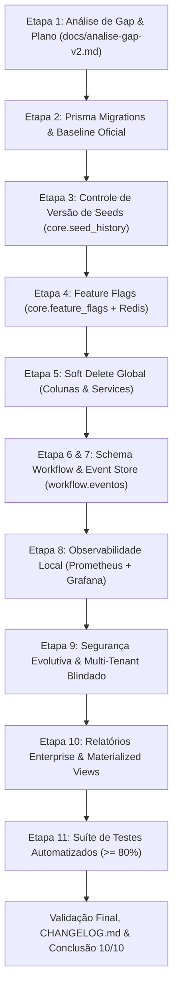

# SIRA Enterprise V2 (10/10) – Análise de Gap e Plano de Execução Arquitetural
**Documento Oficial de Engenharia & Governança de Transição**  
**Versão:** 2.0.0-PROD  
**Data:** 07 de Novembro de 2026  
**Status:** Aprovado para Planejamento e Execução  
**Autor:** Equipe de Arquitetura, Staff Engineering, DBA PostgreSQL e Especialistas Full Stack SIRA

---

## 1. Visão Geral e Contexto Executivo

O **SIRA (Sistema Integrado de Recursos e Agendamento)** encontra-se plenamente operacional em sua versão inicial, composto por:
- **Backend:** NestJS 10+, TypeScript, Prisma ORM 6.4+, PostgreSQL 16, Redis 7, JWT, RBAC de 4 níveis e multi-tenancy contextual (`AsyncLocalStorage`).
- **Frontend:** React 18, Vite, TypeScript, TailwindCSS, Radix UI, TanStack Query, com barramento micro-kernel de módulos e adaptadores desacoplados.
- **Infraestrutura:** Docker Compose orquestrando PostgreSQL 16, Redis 7 e pgAdmin 4 com topologia de banco duplo (`sira` produção e `sira_teste` homologação).

O objetivo deste documento é orientar a evolução do SIRA rumo ao patamar **Enterprise 10/10**, conforme formalizado no [`Melhoria/PRD_V2_10_10.md`](file:///c:/Users/VINICIUS/Documents/GitHub/SIRA/Melhoria/PRD_V2_10_10.md), **sem reescrever a arquitetura**, **sem introduzir tecnologias desnecessárias** (como Kafka, RabbitMQ ou Kubernetes), **sem quebrar compatibilidade retroativa** e mantendo o monorepo modular ágil, confiável e 100% testável localmente.

---

## 2. Matriz de Gap por EPIC (Análise Detalhada)

A seguir, confrontamos a **Situação Atual** com a **Situação Desejada**, mapeando as **Ações Necessárias**, **Riscos**, **Impactos** e **Dependências** para cada um dos 10 EPICs.

```
┌────────────────────────────────────────────────────────────────────────────────────────────────┐
│                              MATRIZ DE TRANSIÇÃO SIRA V1 ➔ V2                                 │
├───────────────────────────────┬────────────────────────────────┬───────────────────────────────┤
│          COMPONENTE           │        SITUAÇÃO ATUAL (V1)     │      SITUAÇÃO DESEJADA (V2)   │
├───────────────────────────────┼────────────────────────────────┼───────────────────────────────┤
│ Governança de Banco           │ DDLs manuais em database/init  │ Prisma Migrate dev/deploy     │
│ Gestão de Seeds               │ Scripts SQL brutos             │ core.seed_history idempotente │
│ Feature Flags                 │ Inexistente (estático)         │ core.feature_flags + Redis    │
│ Deleção de Registros          │ Hard Delete pontual            │ Soft Delete Global auditado   │
│ Orquestração de Processos     │ Regras isoladas por módulo     │ Schema workflow unificado     │
│ Rastreabilidade de Negócio    │ Logs de auditoria HTTP         │ workflow.eventos (Event Store)│
│ Monitoramento & Métricas      │ Healthchecks básicos           │ Prometheus + Grafana nativo   │
│ Segurança Multi-Tenant        │ Validação Header isolada       │ Validação Tripla (JWT+Hdr+Ctx)│
│ Inteligência & Relatórios     │ Agrupamento dinâmico em SQL    │ Materialized Views + Export   │
│ Cobertura de Testes           │ Testes pontuais de integração  │ Suíte >= 80% (Unit, E2E)      │
└───────────────────────────────┴────────────────────────────────┴───────────────────────────────┘
```

---

### EPIC 1 – Governança de Banco de Dados Profissional

#### Situação Atual
- O banco de dados foi estruturado através de scripts SQL manuais em `database/init/` (`01_extensions.sql` até `07_seed_academico.sql`).
- O Prisma ORM é utilizado no backend como cliente introspectado (`prisma db pull`), mas a pasta `database/migrations/` contém apenas um `.gitkeep`.
- As cargas de dados (`01_seed_producao.sql` e `02_seed_teste_carga.sql`) são injetadas diretamente via linha de comando (`psql`) sem histórico versionado de aplicação.

#### Situação Desejada
- O **Prisma Migrate** torna-se a única fonte da verdade para o ciclo de vida do DDL (`prisma migrate dev` e `prisma migrate deploy`).
- Diretório canônico `database/migrations` contendo histórico formal e reprodutível de todas as alterações estruturais.
- Criação da tabela `core.seed_history` (`id`, `versao`, `descricao`, `executado_em`, `executado_por`).
- Runner unificado e idempotente de seeds em TypeScript (`database/seed-runner.ts`) com verificação prévia no histórico antes de executar.
- Manual oficial em `database/README_MIGRATIONS.md`.

#### Ações Necessárias
1. Mapear o estado inicial do schema Prisma existente como a migração baseline (`0_init`).
2. Configurar o caminho de migrações sincronizado com `database/migrations`.
3. Adicionar o modelo `seed_history` no schema `core` do Prisma.
4. Desenvolver o script idempotente `database/seed-runner.ts` que lê arquivos de seed, confere a versão em `core.seed_history` e aplica via transação Prisma.
5. Elaborar o documento `database/README_MIGRATIONS.md` detalhando comandos de workflow para desenvolvimento e produção.

#### Riscos
- Risco de conflito de checksum de migração caso o banco local possua DDL divergente do schema Prisma.
- *Mitigação:* Usar `prisma migrate resolve --applied` ou baseline limpo garantindo compatibilidade estrita com o banco atual.

#### Impactos
- `apps/api/prisma/schema.prisma`
- `database/migrations/*`
- `database/seed-runner.ts`
- `package.json` (scripts `db:migrate`, `db:seed`)

#### Dependências
- Conectividade PostgreSQL 16 ativa e credenciais de administrador em `.env`.

---

### EPIC 2 – Arquitetura de Feature Flags

#### Situação Atual
- Funcionalidades são ativadas/desativadas diretamente em código-fonte ou variáveis de ambiente estáticas, exigindo re-deploy e reinicialização para alterações.
- O frontend e o backend não possuem canal unificado em tempo real para controle de releases progressivos (canary/dark launch).

#### Situação Desejada
- Tabela `core.feature_flags` armazenando:
  - `id UUID PRIMARY KEY`
  - `nome VARCHAR(100) UNIQUE NOT NULL`
  - `ativo BOOLEAN DEFAULT false`
  - `ambiente VARCHAR(50) DEFAULT 'all'`
  - `descricao TEXT`
  - `atualizado_em TIMESTAMPTZ`
  - `atualizado_por UUID`
- Flags padrão inicializadas:
  1. `optimizer_enabled`: false
  2. `reports_enabled`: true
  3. `teacher_swap_enabled`: true
  4. `dashboard_advanced`: true
  5. `experimental_scheduler`: false
- Caching de alta performance no **Redis 7** (TTL de 60 segundos com invalidação imediata via canal Pub/Sub ou mutação).
- **Backend:** `FeatureFlagModule`, `FeatureFlagService` e decorator/guard `@RequireFeatureFlag('nome_flag')`.
- **Frontend:** Provider React (`FeatureFlagProvider`) e hook reativo `useFeatureFlag('nome_flag')`.
- Auditoria de mutação de flags registrada em `auditoria.logs`.

#### Ações Necessárias
1. Adicionar o model `feature_flags` no schema `core` do Prisma e gerar migration.
2. Criar `FeatureFlagModule` no NestJS com caching em Redis via `RedisCacheService`.
3. Criar `FeatureFlagGuard` para proteção declarativa de rotas da API.
4. Disponibilizar endpoint `GET /api/v1/feature-flags` aberto para o frontend (consumindo Redis).
5. Criar `FeatureFlagContext` e `useFeatureFlag` no React (`apps/web`).

#### Riscos
- Sobrecarga de chamadas de feature flag no Redis ou latência em rotas de alto tráfego.
- *Mitigação:* Cache L1 local em memória com sincronização L2 em Redis (fallback de 5s).

#### Impactos
- `apps/api/src/modules/feature-flags/*`
- `apps/web/src/contexts/FeatureFlagContext.tsx`
- `apps/web/src/hooks/useFeatureFlag.ts`

#### Dependências
- EPIC 1 (Migration Prisma).
- Redis 7 operacional.

---

### EPIC 3 – Soft Delete Corporativo

#### Situação Atual
- Algumas tabelas possuem campo `ativo BOOLEAN`, porém a remoção de registros em determinados endpoints executa ou prepara `DELETE` físico (`batch.delete` ou `prisma.*.delete`).
- Não há rastreabilidade de quem realizou a exclusão e em qual data/hora exata o registro foi desativado no modelo unificado.

#### Situação Desejada
- Padrão uniforme de Soft Delete nas entidades corporativas fundamentais:
  - `core.usuarios`
  - `academico.docentes`
  - `academico.turmas`
  - `academico.ambientes`
  - `academico.cursos`
- Campos obrigatórios:
  - `ativo BOOLEAN DEFAULT true`
  - `excluido_em TIMESTAMPTZ NULL`
  - `excluido_por UUID NULL`
- Nenhuma operação disparada pela interface deve executar `DELETE` físico no banco.
- Repositórios, Services e Prisma Queries devem aplicar automaticamente filtro `excluido_em IS NULL` em listagens e buscas comuns.
- Endpoints de exclusão convertidos para atualização de Soft Delete com auditoria (`auditoria.logs`).

#### Ações Necessárias
1. Adicionar `excluido_em` e `excluido_por` nas 5 tabelas no Prisma Schema e gerar migration.
2. Implementar extensão/middleware do Prisma ou helpers globais nos repositórios para filtrar registros excluídos por padrão.
3. Atualizar controllers e services dos módulos (`users`, `docentes`, `turmas`, `ambientes`, `cursos`) substituindo `prisma.delete` por `prisma.update({ data: { ativo: false, excluido_em: new Date(), excluido_por: userId } })`.
4. Garantir que o frontend exiba confirmações de desativação em vez de promessas de expurgo físico.

#### Riscos
- Índices únicos (`UNIQUE`) quebrem ao tentar recriar um registro com mesmo código/email de um registro soft-deleted.
- *Mitigação:* Adequar índices únicos para parciais (`WHERE excluido_em IS NULL`) nas migrações SQL.

#### Impactos
- Entidades `usuarios`, `docentes`, `turmas`, `ambientes`, `cursos`.
- Todos os endpoints de exclusão existentes.

#### Dependências
- EPIC 1 (Prisma Migrate).

---

### EPIC 4 – Event Store Operacional

#### Situação Atual
- Existe a tabela `auditoria.logs` que armazena auditoria técnica HTTP (método, IP, diff de dados).
- Não há um Event Store de domínio desacoplado para representar eventos semânticos de negócio (ex: "DocenteCriado", "PromocaoExecutada", "SwapAprovado") de forma consumível por motores assíncronos e relatórios.

#### Situação Desejada
- Tabela `workflow.eventos` modelada especificamente para Event Sourcing de domínio:
  - `id UUID PRIMARY KEY DEFAULT gen_random_uuid()`
  - `tipo VARCHAR(100) NOT NULL` (ex: `USUARIO_CRIADO`, `DOCENTE_CRIADO`, `TURMA_CRIADA`, `AGENDAMENTO_CRIADO`, `PROMOCAO_EXECUTADA`, `SWAP_APROVADO`)
  - `entidade VARCHAR(100) NOT NULL`
  - `entidade_id VARCHAR(255) NOT NULL`
  - `payload_jsonb JSONB NOT NULL`
  - `usuario_id UUID NULL`
  - `unidade_id UUID NULL`
  - `criado_em TIMESTAMPTZ DEFAULT now() NOT NULL`
- Eventos totalmente imutáveis (proibido `UPDATE` e `DELETE`).
- EventBus interno no NestJS desacoplado (baseado em EventEmitter2 nativo) persistindo eventos automaticamente em segundo plano.

#### Ações Necessárias
1. Criar o schema `workflow` e a tabela `eventos` via Prisma Migrate.
2. Criar `EventStoreService` em `apps/api/src/modules/event-store/`.
3. Integrar emissão dos 6 eventos canônicos nos serviços correspondentes:
   - `UsersService` -> `USUARIO_CRIADO`
   - `DocentesService` -> `DOCENTE_CRIADO`
   - `TurmasService` -> `TURMA_CRIADA`
   - `AgendamentosService` -> `AGENDAMENTO_CRIADO`
   - `SyncService` -> `PROMOCAO_EXECUTADA`
   - `SubstituicoesService` -> `SWAP_APROVADO`
4. Expor consulta de histórico de eventos por entidade para auditoria executiva.

#### Riscos
- Crescimento rápido de volume na tabela de eventos.
- *Mitigação:* Índices otimizados por `(entidade, entidade_id)`, `tipo` e `criado_em DESC`.

#### Impactos
- Novo módulo `EventStoreModule`.
- Injeção em serviços essenciais do backend.

#### Dependências
- EPIC 1 (Prisma Migrate).
- EPIC 5 (Schema Workflow).

---

### EPIC 5 – Novo Schema Workflow

#### Situação Atual
- O módulo de substituições/trocas de horários opera diretamente na tabela `planejamento.substituicoes`.
- Não existe um motor genérico de orquestração de solicitações, aprovações em múltiplos níveis, fluxos parametrizáveis e assinaturas.

#### Situação Desejada
- Schema dedicado `workflow` abrigando as tabelas:
  - `workflow.fluxos`: Definição dos tipos de processos (troca docente, reserva extraordinária, aprovação de grade, promoção entre bancos).
  - `workflow.etapas`: Etapas ordenadas de cada fluxo (ex: 1=Parecer Coordenação, 2=Homologação Direção).
  - `workflow.solicitacoes`: Instâncias de processos abertos por usuários ou unidades.
  - `workflow.aprovacoes`: Votos, pareceres, aprovações ou rejeições pontuais de cada etapa.
  - `workflow.assinaturas`: Registro digital e hash de confirmação de quem aprovou/homologou.
  - `workflow.historicos`: Linha do tempo imutável das transições de estado.
- Arquitetura plugável e desacoplada: novos processos de negócio corporativos (ex: reserva de laboratório especial, compra de insumos) plugam-se diretamente a este motor sem necessidade de novas tabelas de aprovação.

#### Ações Necessárias
1. Modelar as 6 tabelas no Prisma Schema dentro do schema `workflow`.
2. Gerar migration oficial via Prisma.
3. Criar `WorkflowModule`, `WorkflowService` e `WorkflowController` no NestJS.
4. Adaptar o fluxo de trocas docentes e de promoção de cenários de teste para registrar e consultar o motor de workflow.

#### Riscos
- Complexidade excessiva para fluxos simples de troca.
- *Mitigação:* Manter compatibilidade com os endpoints existentes de `substituicoes`, integrando o workflow por baixo dos panos (bridge pattern).

#### Impactos
- `apps/api/src/modules/workflow/*`
- `apps/api/prisma/schema.prisma`

#### Dependências
- EPIC 1 (Prisma Migrate).

---

### EPIC 6 – Observabilidade Local (Prometheus + Grafana)

#### Situação Atual
- Monitoramento baseado em `docker compose ps` e logs padrão do stdout.
- Ausência de métricas históricas de latência HTTP, consumo de memória da API NestJS, conexões ativas no PostgreSQL e métricas de acerto/erro do cache Redis.

#### Situação Desejada
- **Docker Compose** ampliado com:
  - `prometheus`: Coletor de métricas temporais (scraping a cada 10s, retenção configurada).
  - `grafana`: Interface visual de dashboards pré-provisionada via volume declarativo (`infra/monitoring/grafana`).
- **Backend NestJS:**
  - Exportador de métricas Prometheus na rota `/metrics` (via `prom-client` ou interceptor próprio seguro).
  - Métricas registradas:
    - Uso de CPU e Memória (Processo Node.js / V8 heap).
    - Latência de respostas HTTP (histograma por rota e status code).
    - Contagem de erros HTTP 4xx e 5xx.
    - Conexões e latência do pool Prisma / PostgreSQL.
    - Hits, misses e operações no Redis.
- Dashboards prontos carregados automaticamente no Grafana:
  - *SIRA Overview:* Visão geral de saúde, throughput e erros.
  - *SIRA Database & Cache:* Conexões PG e performance Redis.

#### Ações Necessárias
1. Criar pasta `infra/monitoring/` com `prometheus.yml`, datasources e dashboards JSON do Grafana.
2. Atualizar `docker-compose.yml` adicionando serviços `prometheus` (porta 9090) e `grafana` (porta 3001) na rede `sira-network`.
3. Instalar e configurar exportação de métricas na API NestJS via `MetricsModule`.
4. Proteger o endpoint `/metrics` contra acesso público não autorizado.

#### Riscos
- Sobrecarga de memória pelos contêineres adicionais no ambiente local.
- *Mitigação:* Usar imagens Alpine leves com limites de memória configurados no compose (`mem_limit: 256m`).

#### Impactos
- `docker-compose.yml`
- `infra/monitoring/*`
- `apps/api/src/modules/metrics/*`

#### Dependências
- Docker Compose e portas 9090 e 3001 disponíveis na máquina.

---

### EPIC 7 – Segurança Evolutiva & Multi-Tenant Blindado

#### Situação Atual
- O multi-tenancy é interceptado pelo `TenantInterceptor`, que lê o cabeçalho `X-Unidade-Id` e o compara com o `unidadeId` do JWT.
- Se o cabeçalho não for informado, adota a unidade do token, mas não há validação estrita de integridade contra adulteração em trânsito caso o contexto seja alterado em memória.
- O Refresh Token é rotacionado de forma atômica no Redis, mas ainda não armazena metadados de `DeviceID`, `Fingerprint` e mecanismo de revogação global em caso de comprometimento.

#### Situação Desejada
- **Validação Tripla de Multi-Tenancy:**
  1. `Tenant do JWT`: Unidade autorizada contida no token assinado criptograficamente.
  2. `Tenant do Header`: `X-Unidade-Id` enviado pelo frontend.
  3. `Tenant do Contexto`: Unidade instanciada no `AsyncLocalStorage` (`TenantContext`).
  - *Regra Estrita:* Para usuários não-administradores, os 3 valores **devem coincidir obrigatoriamente**. Caso haja qualquer divergência, a requisição é abortada imediatamente com **HTTP 403 Forbidden**.
  - Para Administradores Globais, a troca de unidade é permitida desde que assinada e contextualizada de forma rastreável.
- **Hardening de Sessão e Tokens:**
  - Inclusão de `deviceId` e `fingerprint` (hash do User-Agent + IP) no payload do Refresh Token.
  - Endpoint de **Revogação Global (`POST /auth/revoke-all`)**: Invalida todas as sessões ativas do usuário no Redis instantaneamente.
- **Rate Limit por IP e Usuário:**
  - Aplicação de Throttling agressivo em rotas críticas: `/auth/login` (máx. 5 req/min), `/auth/refresh` (máx. 10 req/min), `/sync/promote` (máx. 3 req/min) e `/sync/mirror` (máx. 3 req/min).

#### Ações Necessárias
1. Atualizar `TenantInterceptor` para implementar a validação tripla estrita com rejeição 403 imediata.
2. Evoluir `AuthService` para gerar tokens com `deviceId` e registrar fingerprint no Redis.
3. Criar método `revokeAllUserSessions(userId)` no `RedisCacheService` e expor endpoint na API.
4. Implementar guard de Rate Limit baseado em Redis para as rotas críticas.

#### Riscos
- Bloqueio acidental de requisições legítimas do frontend caso o header não esteja sincronizado na troca de telas.
- *Mitigação:* Garantir que `apiService.ts` no frontend injete o header `X-Unidade-Id` de forma sincronizada com o estado da sessão ativa.

#### Impactos
- `apps/api/src/modules/tenant/tenant.interceptor.ts`
- `apps/api/src/modules/auth/*`
- `apps/web/src/services/apiService.ts`

#### Dependências
- EPIC 2 (Redis operacional).

---

### EPIC 8 – Camada de Relatórios Enterprise

#### Situação Atual
- Relatórios são gerados por consultas pontuais agregadas em tempo de execução via API ou gerados localmente no frontend.
- O schema `relatorios` existe no banco mas ainda não possui Materialized Views preparadas para agregação em alta escala.

#### Situação Desejada
- Criação e governança de **4 Materialized Views** de alto desempenho no schema `relatorios`:
  1. `relatorios.vw_ocupacao_ambientes`: Taxa de ocupação percentual por ambiente, bloco, turno e dia da semana.
  2. `relatorios.vw_carga_docentes`: Carga horária semanal acumulada por professor vs limite contratual.
  3. `relatorios.vw_turmas_ativas`: Resumo consolidado de turmas em andamento, alunos, cursos e carga horária cumprida.
  4. `relatorios.vw_conflitos`: Resumo histórico e analítico de colisões evitadas e conciliadas.
- Job/rotina de atualização programada (`REFRESH MATERIALIZED VIEW CONCURRENTLY`).
- Camada desacoplada de exportação em múltiplos formatos: **PDF**, **XLSX** e **CSV**.
- Módulo `ReportsModule` na API NestJS entregando os dados consolidados com filtros por período e unidade.

#### Ações Necessárias
1. Criar as 4 views materializadas via migration do Prisma (`08_materialized_views_relatorios.sql`).
2. Criar índices únicos nas views materializadas para possibilitar `REFRESH CONCURRENTLY`.
3. Criar `ReportsModule` no backend com serviços de exportação em CSV (nativo/fast-csv), XLSX (exceljs) e PDF (pdfkit).
4. Criar controller com endpoints de streaming de download:
   - `GET /api/v1/relatorios/ocupacao?format=pdf|xlsx|csv`
   - `GET /api/v1/relatorios/carga-docente?format=pdf|xlsx|csv`
   - `GET /api/v1/relatorios/turmas?format=pdf|xlsx|csv`
   - `GET /api/v1/relatorios/conflitos?format=pdf|xlsx|csv`

#### Riscos
- Bloqueio de leituras durante o refresh das views materializadas.
- *Mitigação:* Usar obrigatoriamente `REFRESH MATERIALIZED VIEW CONCURRENTLY` com índices únicos adequados.

#### Impactos
- Schema `relatorios`.
- Novo módulo `ReportsModule` na API.

#### Dependências
- EPIC 1 (Prisma Migrate).

---

### EPIC 9 – Testes Automatizados (Meta: >= 80% Cobertura)

#### Situação Atual
- O backend possui testes pontuais (ex: `apps/api/test-sync-flow.mjs`).
- O frontend compila limpo sem erros, mas não conta com suíte automatizada de testes unitários e de integração cobrindo os módulos principais.

#### Situação Desejada
- Cobertura de testes unitários e de integração igual ou superior a **80%** nos caminhos críticos corporativos:
  1. Fluxo de Autenticação, Refresh e Revogação.
  2. Validação de RBAC e permissões por papel.
  3. Isolamento Multi-Tenancy (validação tripla e rejeição 403).
  4. Detecção e conciliação de conflitos em Agendamentos.
  5. Sincronização e promoção atômica entre bancos de teste e produção.
  6. Motor de Workflow e registro no Event Store.
- Ferramentas padronizadas:
  - **Backend:** Vitest / Jest + Supertest (`tests/unit`, `tests/integration`).
  - **Frontend:** Vitest + React Testing Library.
  - **E2E:** Playwright (`tests/e2e`).
- Script raiz consolidado: `npm run test:all` e `npm run test:cov`.

#### Ações Necessárias
1. Configurar Vitest/Jest com thresholds de cobertura de 80% em `apps/api` e `apps/web`.
2. Implementar testes unitários para Services essenciais (`AuthService`, `TenantContext`, `AgendamentosService`, `FeatureFlagService`, `WorkflowService`).
3. Implementar testes de integração E2E com Supertest para controllers e guards.
4. Estruturar diretórios padrão `tests/unit`, `tests/integration` e `tests/e2e`.

#### Riscos
- Flakiness em testes dependentes de Redis ou PostgreSQL.
- *Mitigação:* Utilizar mocks limpos para testes unitários e instâncias dedicadas de teste para integração.

#### Impactos
- `apps/api/vitest.config.ts`
- `tests/*`
- Scripts de CI/CD.

#### Dependências
- EPICs 1 a 8 concluídos.

---

### EPIC 10 – Governança & Não-Complexidade Prematura

#### Diretriz Arquitetural Inegociável
- **Proibido expressamente:** Introduzir Kubernetes, mensageria externa (Kafka, RabbitMQ, SQS) ou decomposição prematura em microsserviços.
- O SIRA permanece como um **Monolito Modular de Alto Desempenho** (Modular Monolith) orientado a domínios limpos, onde a comunicação entre módulos ocorre via interfaces tipadas em TypeScript e injeção de dependência do NestJS, suportado por PostgreSQL e Redis.
- Essa abordagem garante manutenção simples por equipe enxuta, deploy imediato via Docker Compose, tempo de resposta na faixa de sub-milissegundos e consumo de recursos mínimo.

---

## 3. Plano de Migração e Sequência de Execução por Etapas

Para garantir segurança absoluta, zero quebra de contratos e compatibilidade total com o sistema atual, a implementação seguirá rigorosamente a ordem abaixo:



---

## 4. Matriz de Riscos & Plano de Contingência

| Risco Mapeado | Severidade | Probabilidade | Plano de Contingência / Mitigação |
| :--- | :---: | :---: | :--- |
| **Divergência de DDL no Prisma Migrate** | Alta | Baixa | Utilizar baseline inicial compatível com o schema atual via `--create-only` e validar contra o banco real antes de aplicar. |
| **Bloqueio de usuário por Multi-Tenant Triplo** | Média | Média | Fornecer fallback transparente para administradores e atualizar o client web para sincronizar o header automaticamente. |
| **Queda de desempenho em Materialized Views** | Alta | Baixa | Criar índices exclusivos e utilizar sempre a cláusula `CONCURRENTLY` para evitar lock de leitura. |
| **Inconsistência de Soft Delete em Unique Keys** | Alta | Média | Converter índices UNIQUE das tabelas afetadas para índices parciais com filtro `WHERE excluido_em IS NULL`. |
| **Falta de recursos locais (CPU/RAM) com Prometheus/Grafana** | Baixa | Média | Definir limites estritos de memória no Compose (`256MB` por serviço de monitoramento). |

---

## 5. Critérios de Sucesso e Aceite Final

1. **Execução Local Íntegra:** O comando `docker compose up -d` deve subir toda a infraestrutura (Postgres, Redis, pgAdmin, Prometheus, Grafana) sem conflitos de porta.
2. **Migrações Oficiais Ativas:** `npx prisma migrate status` deve reportar banco 100% sincronizado com histórico limpo.
3. **Seeds Rastreáveis:** A tabela `core.seed_history` deve registrar com precisão data, versão e autor de cada carga executada pelo `database/seed-runner.ts`.
4. **Feature Flags Dinâmicas:** Alteração de flags no banco deve refletir instantaneamente no Redis e no frontend sem necessidade de reinicializar a aplicação.
5. **Zero Exclusão Física:** Comandos de exclusão pela interface ou API devem gerar `excluido_em` preenchido e registro imutável em `workflow.eventos`.
6. **Segurança Verificada:** Tentativa de requisição com `X-Unidade-Id` divergente do JWT para perfil não-admin deve retornar **HTTP 403 Forbidden**.
7. **Relatórios Operacionais:** Download de relatórios em PDF, XLSX e CSV gerados diretamente a partir das Materialized Views em sub-segundos.
8. **Cobertura de Testes:** Relatório de cobertura reportando índice igual ou superior a 80% nos serviços essenciais do backend e frontend.
